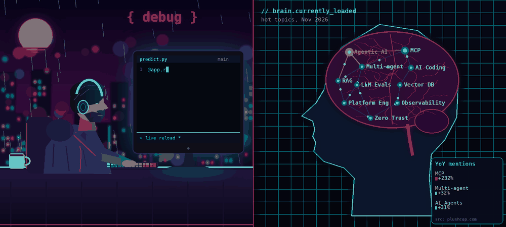

  

  

  

  
  
  
  

  

---

### 🚀 Featured projects

| Project | What it is | Stack |
|---|---|---|
| **AMR-Predict v2.0** | GenAI-powered clinical decision support for antimicrobial resistance prediction, with SHAP explanations | Python, Flask, XGBoost, React, OpenAI API |
| **OpsPilot** | Incident management backend: JWT auth, Zod validation, SEV1-SEV4 lifecycle | TypeScript, Express, PostgreSQL, Docker |
| **Retail E-commerce Analytics** | Streaming and batch analytics pipeline with a dashboard | Kafka, HDFS, MapReduce, Flask |

### 🛠️ Languages and tools

  
  
  
  
  
  
  
  
  
  
  
  
  
  
  
  

---

### 🐍 Contribution snake

  <picture>
    <source media="(prefers-color-scheme: dark)" srcset="https://raw.githubusercontent.com/harshavardhana-v/harshavardhana-v/output/github-contribution-grid-snake-dark.svg" />
    <source media="(prefers-color-scheme: light)" srcset="https://raw.githubusercontent.com/harshavardhana-v/harshavardhana-v/output/github-contribution-grid-snake.svg" />
    
  </picture>

  

